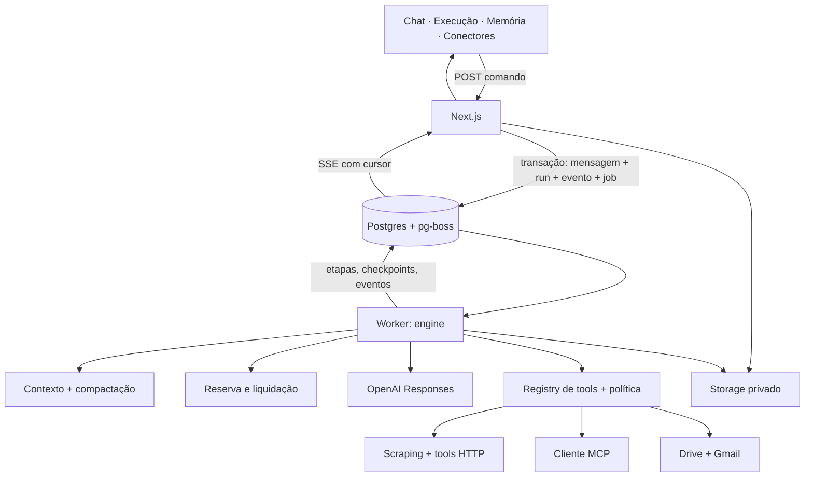

# Chat Tess

Chat em que cada resposta tem uma **execução inspecionável**: fontes consultadas, ferramentas, falhas, compactações e consumo. A execução roda num worker durável, sobrevive a recarregar a página e é auditada.

- Conversa com streaming, anexos (imagem e PDF), busca na web, leitura de páginas, tools HTTP cadastradas pelo usuário, servidores **MCP** e conectores **Google Drive** e **Gmail** (somente leitura).
- Respostas citam as fontes realmente obtidas (`[S1]`, `[S2]`…); referências inventadas pelo modelo são ignoradas.
- **Ver execução** em cada resposta; painel de **Memória** com o resumo exatamente como enviado ao modelo.
- Créditos com reserva antes da chamada e liquidação única por tentativa; cap global; cotas ajustáveis pelo admin.
- Compartilhamento por snapshot ou live, com prévia, expiração e revogação.

Documentos: [plano](docs/PLANO.md) · [decisões](docs/DECISOES.md) · [resultados medidos](docs/SPIKE.md) · [deploy](docs/DEPLOY.md) · [roteiro do vídeo](docs/ROTEIRO-VIDEO.md).

## Arquitetura

Monólito modular TypeScript com dois processos: **web** (Next.js: interface, autenticação, comandos curtos, SSE) e **worker** (turnos, tools, compactação, chamadas ao modelo). Postgres guarda estado, fila (pg-boss), checkpoints, eventos e consumo.



Garantias e seus limites:

- **Um turno, um run.** O POST usa chave de idempotência. Mensagem, run, evento e job são confirmados numa única transação, e só pode haver um run ativo por conversa.
- **Recuperação.** O worker trabalha com lease, heartbeat e fencing por versão. Etapas confirmadas são reaproveitadas, e uma tentativa interrompida fica como `unknown`, sem texto concatenado.
- **Efeitos externos não têm "exatamente uma vez".** Leituras podem ser repetidas; ações com efeito externo nunca são repetidas automaticamente.
- **Créditos em micro-USD inteiros.** As reservas de usuário e global são feitas com ordem fixa de locks, e o consumo sem `usage` fica `unknown` com a reserva mantida.
- **Política contra exfiltração.** Com dado privado no contexto, um destino novo é bloqueado e a busca nativa é retirada da chamada. A regra é aplicada pelo sistema, não pedida ao modelo. Um aviso acima do campo de mensagem explica o bloqueio, e o dono pode liberar o acesso externo naquela conversa com um clique: a liberação é explícita, revogável e auditada.

## Rodar localmente

Requisitos: Node 22+ e Docker.

```bash
npm install
```

```bash
cp .env.example .env
```

```bash
npm run db:up
```

```bash
npm run db:migrate
```

Em terminais separados:

```bash
npm run dev
```

```bash
npm run dev:worker
```

```bash
npm run mcp-demo
```

Abra `http://localhost:3000` e use **Experimentar demo**. Com `LLM_PROVIDER=fake`, não é preciso chave nem há custo: o provider fake é determinístico e aceita gatilhos como `[[tool:nome {"arg":1}]]`, `[[fail:5xx]]` e `[[fail:4xx]]`. Para a OpenAI e o Google, preencha as variáveis descritas em `.env.example` e em [docs/DEPLOY.md](docs/DEPLOY.md).

## Testes

```bash
npm test
```

```bash
npm run test:e2e
```

- **Vitest (Postgres real):**
  - idempotência e concorrência de saldo;
  - liquidação repetida;
  - queda de worker com fencing;
  - ação externa não repetida;
  - SSRF (metadata, IP privado, redirects);
  - política de exfiltração, incluindo a busca nativa;
  - MCP: sessão perdida e schema alterado;
  - duas compactações sucessivas;
  - compartilhamento e revogação;
  - cotas e auditoria.
- **Playwright** (provider fake, servidores próprios na porta 3101):
  - recarregar no meio do streaming;
  - cancelar;
  - MCP pela interface com fonte citada;
  - snapshot aberto anonimamente e revogado.
- **Métricas medidas:** `npm run metrics` calcula tempo até o primeiro texto, duração e custo por perfil, a partir dos eventos gravados.

## Estrutura

```text
src/
  app/            UI (App Router) e rotas de API curtas
  components/     chat, execução, memória, compartilhamento, conectores, admin
  server/
    auth/         sessão própria, login Google, demo isolada
    runs/         comando de turno, eventos, fila, timeline
    chat/         engine, contexto, compactação
    llm/          adapter OpenAI e provider fake
    tools/        registry, política, scraping, HTTP, MCP
    connectors/   Google (OAuth incremental, Drive, Gmail)
    credits/      preço, reserva, liquidação
    sources/      fontes e citações
    sharing/      snapshot/live
    storage/      anexos, disco local ou bucket S3
    security/     SSRF, criptografia, sanitização
    admin/ audit/ cotas e auditoria
  db/             schema Drizzle e migrations
  worker/         processo do worker
  mcp-demo/       servidor MCP de demonstração (dados sintéticos)
tests/ e2e/       Vitest e Playwright
```

## Limitações assumidas

- O resumo de memória perde detalhes; o histórico completo continua visível e os anexos antigos não são reenviados além do orçamento.
- O `scrape_page` não executa JavaScript.
- MCP: Streamable HTTP com token bearer do dono. OAuth MCP genérico e stdio estão fora do escopo.
- Em modo Testing, Google aceita só os test users cadastrados, e os tokens expiram em 7 dias.
- A aprovação manual de ações (`waiting_approval`) está prevista no modelo de estados, mas não foi implementada: ações bloqueadas pela política são recusadas, não colocadas em espera.
