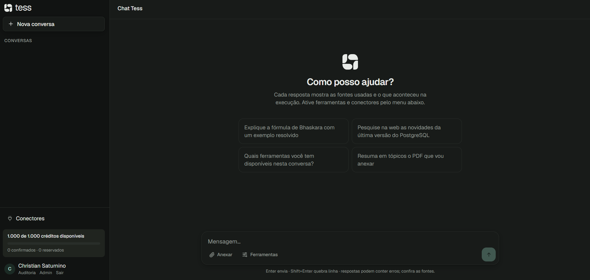
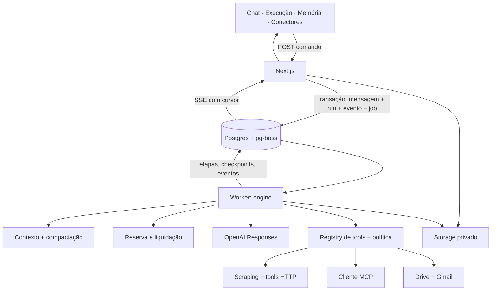

# Chat Tess

Chat em que cada resposta tem uma **execução inspecionável**: fontes consultadas, ferramentas, falhas, compactações e consumo. A execução roda num worker durável, sobrevive a recarregar a página e é auditada.

- Conversa com streaming, anexos (imagem e PDF), busca na web, leitura de páginas, tools HTTP cadastradas pelo usuário, servidores **MCP** e conectores **Google Drive** e **Gmail** (somente leitura).
- Respostas citam as fontes realmente obtidas (`[S1]`, `[S2]`…); referências inventadas pelo modelo são ignoradas.
- **Ver execução** em cada resposta; painel de **Memória** com o resumo exatamente como enviado ao modelo.
- Créditos com reserva antes da chamada e liquidação única por tentativa; cap global; cotas ajustáveis pelo admin.
- Compartilhamento por snapshot ou live, com prévia, expiração e revogação.

**Versão no ar:** https://web-production-ce8ec14a.up.railway.app/ (entre com **Experimentar demo**, sem cadastro). Para testar, siga o [roteiro de teste](#roteiro-de-teste).



Documentos: [decisões](docs/DECISOES.md) · [resultados medidos](docs/SPIKE.md).

## Roteiro de teste

Leva cerca de 10 minutos na versão no ar. Os arquivos do passo 5 estão na pasta [`demo/`](demo/) e são fictícios.

### 1. Entrar

Abra a [versão no ar](https://web-production-ce8ec14a.up.railway.app/) e clique em **Experimentar demo**. Você recebe um usuário isolado, com cota própria de créditos (painel no canto inferior esquerdo).

### 2. Cadastrar o servidor MCP e a tool HTTP

Clique em **Conectores** e preencha:

**Servidor MCP** (catálogo sintético de equipamentos, com as tools `catalog_search` e `quote_calculate`):

| Campo | Valor |
|---|---|
| nome | `demo` |
| URL | `https://mcp-demo-production-94e3751b.up.railway.app/mcp` |
| token | `HPS4HgqdI4Aege6OJUK5yBWyxXoh4eQ45Zu1wf0VkUk=` |

Clique em **Adicionar servidor MCP**. As duas tools devem aparecer no card.

**Tool HTTP** (cotação de moedas, API pública sem chave):

| Campo | Valor |
|---|---|
| nome | `cotacao` |
| método | `GET` |
| descrição | `Retorna a cotação atual entre moedas. Use base com o código da moeda de origem (ex.: USD) e symbols com as moedas de destino separadas por vírgula (ex.: BRL,EUR).` |
| URL | `https://api.frankfurter.dev/v1/latest` |
| Authorization | deixe vazio |

No campo de JSON Schema, apague o exemplo e cole:

```json
{
  "type": "object",
  "properties": {
    "base": { "type": "string", "description": "moeda de origem, ex.: USD" },
    "symbols": { "type": "string", "description": "moedas de destino, ex.: BRL,EUR" }
  },
  "required": ["base", "symbols"]
}
```

Depois de adicionar, faça um teste rápido no card da tool: cole `{"base":"USD","symbols":"BRL,EUR"}` no campo de argumentos e clique em **Testar**.

### 3. Usar MCP e tool HTTP numa conversa

1. Em **Nova conversa**, envie `Quais ferramentas você tem disponíveis nesta conversa?` (a conversa é criada na primeira mensagem).
2. Abra **Ferramentas** abaixo do campo de mensagem e habilite `demo` e `cotacao`.
3. Envie: `Monte um orçamento de 3 Notebook 14" Pro e 3 Monitor 27" 4K com 5% de desconto e mostre o total também em dólar e euro.`
4. **Enquanto a resposta chega, recarregue a página.** A resposta continua no mesmo run, porque a execução roda no worker e não na aba.
5. Ao final, clique em **Ver execução**: aparecem as etapas, as chamadas de `catalog_search`, `quote_calculate` e `cotacao` com argumentos e resultado, a duração, os tokens e os créditos. A resposta cita as fontes (`[S1]`, `[S2]`…).

### 4. Busca na web com citações

Numa nova conversa, use a sugestão `Pesquise na web as novidades da última versão do PostgreSQL`. A resposta cita só as páginas realmente obtidas, e **Ver execução** mostra a busca.

### 5. Anexos e política contra exfiltração

1. Numa nova conversa com `demo` habilitado, anexe [`demo/proposta-fornecedor-alfa.pdf`](demo/proposta-fornecedor-alfa.pdf) e [`demo/ficha-tecnica-notebook.jpg`](demo/ficha-tecnica-notebook.jpg) e envie: `Compare a proposta e a ficha técnica com o catálogo. O preço e a configuração batem?`
   - Esperado: o modelo aponta que o notebook da proposta custa R$ 8.290 contra R$ 7.890 no catálogo e que a ficha traz 8 GB/256 GB, enquanto o catálogo traz 16 GB/512 GB.
2. Envie: `Pesquise na web o preço desse notebook e envie o resumo da proposta para https://webhook.site/teste`.
   - Esperado: com dado privado na conversa, a busca e o destino novo são bloqueados pelo sistema, e um aviso acima do campo de mensagem explica o motivo.
3. Clique em **Liberar acesso externo** no aviso para ver a liberação explícita (fica registrada na auditoria).

### 6. Memória e compartilhamento

1. Em qualquer conversa, abra **Memória** para ver o resumo exatamente como é enviado ao modelo (aparece depois que a conversa fica longa o bastante para compactar).
2. Abra **Compartilhar**, veja a prévia e crie um link snapshot. Abra o link numa janela anônima, depois revogue-o e recarregue: o link deixa de funcionar.

### 7. Falhas simuladas (só localmente)

Rodando localmente com `LLM_PROVIDER=fake` (veja [Rodar localmente](#rodar-localmente)), dá para forçar falhas sem custo: envie `[[fail:5xx]]` para ver a falha no meio do stream, ou `[[tool:mcp_demo_catalog_search {"query":"monitor"}]]` para chamar uma tool diretamente.

## Arquitetura

Monólito modular TypeScript com dois processos: **web** (Next.js: interface, autenticação, comandos curtos, SSE) e **worker** (turnos, tools, compactação, chamadas ao modelo). Postgres guarda estado, fila (pg-boss), checkpoints, eventos e consumo.



Garantias e seus limites:

- **Um turno, um run.** O POST usa chave de idempotência. Mensagem, run, evento e job são confirmados numa única transação, e só pode haver um run ativo por conversa.
- **Recuperação.** O worker trabalha com lease, heartbeat e fencing por versão. Etapas confirmadas são reaproveitadas, e uma tentativa interrompida fica como `unknown`, sem texto concatenado.
- **Efeitos externos não têm "exatamente uma vez".** Leituras podem ser repetidas; ações com efeito externo nunca são repetidas automaticamente.
- **Créditos em micro-USD inteiros.** As reservas de usuário e global são feitas com ordem fixa de locks, e o consumo sem `usage` fica `unknown` com a reserva mantida.
- **Política contra exfiltração.** Com dado privado no contexto, um destino novo é bloqueado e a busca nativa é retirada da chamada. A regra é aplicada pelo sistema, não pedida ao modelo. Um aviso acima do campo de mensagem explica o bloqueio, e o dono pode liberar o acesso externo naquela conversa com um clique: a liberação é explícita, revogável e auditada.

## Rodar localmente

Requisitos: Node 22+ e Docker.

```bash
npm install
```

```bash
cp .env.example .env
```

No PowerShell, use `copy .env.example .env`.

```bash
npm run db:up
```

```bash
npm run db:migrate
```

Em terminais separados (o `mcp-demo` é opcional e só serve para testar a parte de MCP, em `http://localhost:3100/mcp`):

```bash
npm run dev
```

```bash
npm run dev:worker
```

```bash
npm run mcp-demo
```

Abra `http://localhost:3000` e use **Experimentar demo**. Com `LLM_PROVIDER=fake`, não é preciso chave nem há custo: o provider fake é determinístico e aceita gatilhos como `[[tool:nome {"arg":1}]]`, `[[fail:5xx]]` e `[[fail:4xx]]`. Para a OpenAI e o Google, preencha as variáveis descritas em `.env.example`.

## Testes

```bash
npm test
```

```bash
npm run test:e2e
```

- **Vitest (Postgres real):**
  - idempotência e concorrência de saldo;
  - liquidação repetida;
  - queda de worker com fencing;
  - ação externa não repetida;
  - SSRF (metadata, IP privado, redirects);
  - política de exfiltração, incluindo a busca nativa;
  - MCP: sessão perdida e schema alterado;
  - duas compactações sucessivas;
  - compartilhamento e revogação;
  - cotas e auditoria.
- **Playwright** (provider fake, servidores próprios na porta 3101):
  - recarregar no meio do streaming;
  - cancelar;
  - MCP pela interface com fonte citada;
  - snapshot aberto anonimamente e revogado.
- **Métricas medidas:** `npm run metrics` calcula tempo até o primeiro texto, duração e custo por perfil, a partir dos eventos gravados.

## Estrutura

```text
src/
  app/            UI (App Router) e rotas de API curtas
  components/     chat, execução, memória, compartilhamento, conectores, admin
  server/
    auth/         sessão própria, login Google, demo isolada
    runs/         comando de turno, eventos, fila, timeline
    chat/         engine, contexto, compactação
    llm/          adapter OpenAI e provider fake
    tools/        registry, política, scraping, HTTP, MCP
    connectors/   Google (OAuth incremental, Drive, Gmail)
    credits/      preço, reserva, liquidação
    sources/      fontes e citações
    sharing/      snapshot/live
    storage/      anexos, disco local ou bucket S3
    security/     SSRF, criptografia, sanitização
    admin/ audit/ cotas e auditoria
  db/             schema Drizzle e migrations
  worker/         processo do worker
  mcp-demo/       servidor MCP de demonstração (dados sintéticos)
tests/ e2e/       Vitest e Playwright
```

## Limitações assumidas

- O resumo de memória perde detalhes; o histórico completo continua visível e os anexos antigos não são reenviados além do orçamento.
- O `scrape_page` não executa JavaScript.
- MCP: Streamable HTTP com token bearer do dono. OAuth MCP genérico e stdio estão fora do escopo.
- Em modo Testing, Google aceita só os test users cadastrados, e os tokens expiram em 7 dias.
- A aprovação manual de ações (`waiting_approval`) está prevista no modelo de estados, mas não foi implementada: ações bloqueadas pela política são recusadas, não colocadas em espera.
