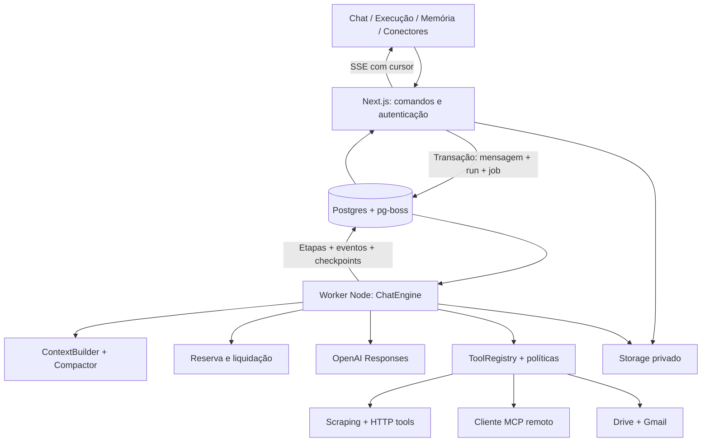

# Chat Tess — arquitetura, produto e plano de entrega

> Revisão pesquisada em 10/11/2026. Entrega: sexta-feira, 13/11, até o fim do dia em Brasília.
> Escopo assumido: todos os obrigatórios, MCP, Google Drive e Gmail. Conectores são compromissos da entrega, não itens condicionados à sobra de tempo.
> Este documento é uma proposta. Garantias e desempenho só serão declarados concluídos após testes de aceite.

## 1. Tese do produto

**Um chat em que cada resposta tem uma execução inspecionável:** fontes consultadas, ferramentas, falhas, compactações e consumo. Cada resposta tem um rodapé com **Ver execução**. Um painel adicional mostra a memória resumida realmente usada após a compactação.

O diferencial é a ligação entre experiência e arquitetura: execução persistida alimenta recuperação, auditoria, contabilização e interface. A timeline mostra ações observáveis, não o raciocínio interno do modelo.

**Demonstração integrada:** comparar orçamento PDF e imagem de especificação com requisitos recebidos no Gmail; consultar um documento no Drive; verificar uma informação na web; usar uma tool MCP. A resposta referencia os materiais consultados. O usuário inspeciona a execução, continua após compactação e compartilha uma versão revisada.

Referências indicam materiais consultados; não provam automaticamente que todas as afirmações estão corretas. Validar IDs de fontes e usar somente trechos/páginas realmente obtidos.

## 2. Arquitetura recomendada

**Monólito modular TypeScript com dois processos: web e worker.** Um repositório, contratos compartilhados, um Postgres e dois serviços de deploy. Não são microserviços independentes por domínio.

- Web: Next.js, autenticação, interface, comandos curtos, upload, share e SSE.
- Worker: executa turnos, tools, compactação e chamadas LLM fora da conexão HTTP.
- Postgres: estado, fila, checkpoints, eventos e consumo.
- Object storage: arquivos e resultados grandes, com referências e permissões no banco.

A fila garante persistência/reagendamento dos jobs; checkpoints da aplicação controlam o progresso dentro do turno. Fila sozinha não recupera etapas.



## 3. Stack e custos das escolhas

| Área | Escolha | Justificativa e custo aceito |
|---|---|---|
| Web | Next.js App Router + TypeScript + Tailwind/shadcn | Interface e endpoints no mesmo projeto. Domínio não depende de Next. Fixar versões estáveis suportadas após spike. |
| Execução | Worker Node + pg-boss | Fila no banco já necessário, sem Redis. Exige checkpoints, idempotência e política de recuperação próprios. |
| Banco | Postgres + Drizzle | Transações, relações, constraints e JSONB para conteúdo heterogêneo. Não colocar campos de autorização/estado somente em JSON. |
| Cloud | Railway: web, worker e Postgres | Processos Node e banco no mesmo ambiente operacional. Dois serviços têm custo e operação próprios. |
| Arquivos | Cloudflare R2, interface Storage pequena | Bytes separados do estado relacional. Limpeza de uploads órfãos e autorização de download explícitas. |
| Identidade | Auth.js para Google login + demo isolada | Identidade e autorização de conectores são conceitos separados. Validar sessão demo no spike. |
| LLM | SDK oficial OpenAI + Responses API | Acesso direto a eventos, usage e itens de contexto. Adapter pequeno, sem promessa de portabilidade universal. |
| MCP | SDK oficial TypeScript, Streamable HTTP | Tools executadas no worker sob política comum. Fixar versão; não misturar imports v1/v2. |
| Google | Cliente oficial Google APIs | Busca e leitura reais, OAuth por usuário. |
| Qualidade | Zod, validador JSON Schema, pino, Vitest, Playwright | Schemas dinâmicos de tools validados em runtime; logs operacionais separados da auditoria de produto. |

Next.js admite deploy Node/Docker; não depende de Vercel. [Deploy Next.js](https://nextjs.org/docs/app/getting-started/deploying).

**Correção:** Railway não implica HTTP ilimitado. A documentação consultada informa até 15 minutos por request com transferência e fechamento após 5 minutos sem transferência. SSE terá heartbeat/reconexão; execução fica no worker. [Limites Railway](https://docs.railway.com/networking/public-networking/specs-and-limits).

pg-boss permite criar jobs na transação da aplicação, inclusive com adapter Drizzle. Mensagem, run e job devem confirmar ou falhar juntos. [Transações pg-boss](https://pgboss.io/api/adapters).

## 4. Alternativas avaliadas e defesa técnica

| Escolha | Alternativa válida | Motivo neste projeto / quando rever |
|---|---|---|
| Web + worker | Turno dentro do route handler | Continuidade e recuperação fazem parte do produto. Versão sem essa promessa poderia começar apenas com rotas. |
| Monólito modular | Serviços separados por domínio | Contratos/banco compartilhados facilitam consistência. Separar quando houver equipes, escalas ou limites de segurança distintos. |
| pg-boss | BullMQ/Redis; Inngest | Reutiliza Postgres e permite enqueue atômico. Reavaliar se fila competir com banco ou workflows exigirem orquestração mais sofisticada. |
| Engine explícito + SDK | AI SDK; LangGraph | Loop restrito ao nosso fluxo, com tentativas/checkpoints ligados a runs e ledger. Aceitamos escrever integração; rever se houver muitos grafos, ramificações ou providers. |
| MCP no worker | MCP remoto no provider | Política e observabilidade comuns às outras tools. Custo: gerenciar conexões e autenticação. |
| Resumo próprio | Compactação nativa OpenAI | Memória legível realmente utilizada é parte do produto. Custo: perda de informação e testes de qualidade. |
| Relacional + JSONB | Banco documental | Relações e consistência concorrente são centrais. Outro armazenamento depende de necessidade medida. |
| SSE | WebSocket | Comando via POST e eventos servidor → cliente atendem. Reavaliar para colaboração bidirecional contínua. |

AI SDK oferece `prepareStep` e `stopWhen`: loop manual não é necessário para auditar. LangGraph tem persistência/checkpoints; Inngest tem etapas duráveis. São alternativas legítimas. A seleção é julgamento de engenharia, não benchmark que prova superioridade. [AI SDK](https://ai-sdk.dev/docs/agents/loop-control), [LangGraph](https://docs.langchain.com/oss/javascript/langgraph/persistence), [Inngest](https://www.inngest.com/docs/durable-execution/primitives).

## 5. Turno, streaming e recuperação

1. POST autoriza conversa, anexos e tools; valida payload, rate limit e chave de idempotência.
2. Transação curta cria mensagem, placeholder do assistant, run, evento inicial e job. Constraint permite um run ativo por conversa. Repetição da mesma chave devolve run existente; payload diferente gera conflito.
3. Retorna runId. UI assina SSE autenticado com cursor e IDs ordenados.
4. Worker reivindica job, valida lease/versão e carrega último checkpoint confirmado. Confere cancelamento e autorização antes de cada etapa.
5. Monta contexto, compacta se preciso, reserva orçamento e registra tentativa antes da chamada externa. Nunca manter transação aberta durante rede.
6. Adapter chama Responses com contexto gerido pela aplicação e `store:false`. Preserva itens de protocolo e reasoning opaco necessários. Não apresentar `store:false` como garantia geral de ausência de retenção pelo provider.
7. Persiste deltas em lotes pequenos antes de enviá-los à UI; não escrever uma linha por token. Eventos semânticos são persistidos imediatamente.
8. Ao concluir chamada, registra saída, usage, liquidação e checkpoint de forma consistente. Function calls usam `call_id`; resultados tornam-se itens `function_call_output` individuais. Busca nativa é executada pelo provider e seus eventos são normalizados para a timeline.
9. Paraleliza apenas tools independentes e autorizadas, respeitando limites. Persiste cada resultado antes de continuar o loop.
10. Finaliza run/mensagem; erro parcial fica visível, sem resposta fictícia de sucesso.

Estados: queued, running, waiting_approval, completed, failed, cancelled, interrupted. Aprovação pendente salva tool/argumentos/versão, libera o worker e reenfileira após decisão autenticada.

**Reconexão:** ler eventos posteriores ao cursor; se eventos antigos expiraram, fornecer snapshot e cursor atual. Polling curto em Postgres é suficiente inicialmente. LISTEN/NOTIFY pode diminuir latência, mas não substitui armazenamento durável.

**Restart:** checkpoints concluídos são reutilizados. Heartbeat, lease e fencing/versionamento impedem sobrescrita por worker antigo. Deltas pertencem à tentativa; uma nova geração substitui explicitamente trecho incompleto, sem concatenar respostas diferentes.

**Limite da garantia:** não há exatamente uma vez para operações externas. Se a API recebeu a chamada e o processo caiu antes de salvar, pode haver resultado/consumo desconhecido. Marcar unknown e manter reserva. Leituras podem ser repetidas com limite; ações com efeito externo não são repetidas automaticamente. Cada nova tentativa LLM pode custar novamente. Centralizar retries e desabilitar retries implícitos não contabilizados.

Limites configuráveis: iterações, duração total, tools, timeout, tamanho de resultados, anexos e concorrência. Cancelamento é cooperativo e contabiliza uso já ocorrido.

[Function calling](https://developers.openai.com/api/docs/guides/function-calling), [reasoning](https://developers.openai.com/api/docs/guides/reasoning).

## 6. Modelo de dados

Esquema conceitual; migrations precisam de FKs, índices e constraints.

| Entidades | Responsabilidade |
|---|---|
| users, accounts, sessions | Identidade, papel e sessão. Demo isolada por visitante ou convite; nunca uma conta pessoal compartilhada. |
| conversations, messages | Dono, configurações, sequência monotônica, blocos, status e run. |
| attachments | Dono, chave privada, tipo validado, tamanho, hash e status. |
| runs | Idempotency key, status, trace, config_snapshot, cancel_requested, lease/version. |
| run_steps, step_attempts | Ordem, tipo, status, request/call IDs, checkpoint, erro e referências de payload. |
| run_events | run_id, seq, tipo e payload sanitizado; unique(run_id, seq). |
| tools, tool_versions, conversation_tools | Schema, configuração cifrada, política, versão e vínculo autorizado com conversa. |
| mcp_servers | Proprietário, endpoint, autenticação, catálogo e estado. |
| connections | Usuário, conta externa, scopes concedidos, tokens cifrados, expiração e status. |
| tool_calls | Step, tool_version, provider_call_id, argumentos/resultados protegidos, erro e duração. |
| sources, message_sources | Origem web/arquivo/Drive/Gmail/MCP, referência, versão/hash se disponível, trecho/página se obtido e autorização. |
| context_summaries | Versão anterior, corte por sequência, resumo estruturado, modelo, orçamento e referências. |
| credit_accounts | Escopo usuário/global, período, limite, confirmado e reservado em inteiros. |
| credit_reservations | Tentativa e valores; pending/settled/released/unknown. |
| usage_ledger | Tentativa única, tokens por categoria, taxas de tools, preço versionado e custo em micro-USD. |
| audit_events | Ator, ação, entidade, run/trace, horário e payload sanitizado; append-only. |
| shares | Hash do token, modo, snapshot/corte, anexos permitidos, expiração e revogação. |
| app_settings | Modelos/capacidades, preços versionados, caps e limites. |

Invariantes: um run ativo por conversa; liquidação única por tentativa; ordem estável; autorização de cada conexão/tool; configurações congeladas por run. Revogação é revalidada antes de cada chamada.

Auditoria das mutações participa da transação correspondente. Papel da aplicação não tem UPDATE/DELETE no ledger/auditoria; correções usam lançamentos compensatórios. Isso não impede um administrador do banco de alterar dados. Payloads não incluem secrets indiscriminadamente.

Estado relacional com trilha de eventos não é event sourcing completo; registro não implica replay determinístico de LLMs ou fontes externas.

## 7. Créditos e cap global

- Micro-USD inteiros internamente; créditos na UI (`1 crédito = US$ 0,001`). Não usar float para saldo.
- Reservar entrada estimada conservadora + saída máxima + tools pagas antes da chamada. Reservas de usuário/global na mesma transação, com ordem fixa de locks.
- Disponível = limite − confirmado − reservado. Incluir compactação e títulos; sem saldo, não iniciar.
- Liquidar uma vez por tentativa com usage real e liberar diferença. Guardar preço e modelo usados. Cache não é somado novamente à entrada total; reasoning não é contado duas vezes quando integra output.
- Tarifas de tools nativas são separadas. Não inventar custo para MCP; registrar custo externo somente quando conhecido. Infra tem orçamento operacional separado.
- Falha sem usage não custa zero: unknown, reserva mantida e reconciliação quando houver evidência. UI distingue estimado, reservado e confirmado.
- Um cap estrito exige limites superiores válidos. Modalidade/tool sem teto confiável deve ser limitada ou desabilitada sob cap estrito; estimativa não garante matematicamente a fatura externa.
- Admin ajusta cotas com auditoria. Demo tem limites e proteção global contra criação ilimitada de novas sessões.

## 8. Compactação e memória visível

A OpenAI oferece compactação nativa automática e standalone; o item resultante é opaco. Resumo próprio é escolha de produto, não necessidade da API. [Compactação](https://developers.openai.com/api/docs/guides/compaction).

Escolha: resumo estruturado realmente enviado como contexto, exibido no painel de memória. Não rotular um resumo auxiliar como conteúdo de um estado opaco.

1. Antes de cada chamada, orçamento = janela do modelo − saída reservada − margem. Considerar instruções, schemas, anexos e resultados, calibrando com usage.
2. Gatilho antecipado configurável; modo demo reduz orçamento sem alterar algoritmo.
3. Resumir resumo anterior + prefixo novo, em blocos que caibam no summarizer. Preservar últimos turnos completos e pares de chamada/resultado necessários.
4. Persistir versão/corte antes de ativá-los. Falha não apaga contexto anterior.
5. Resumo e conteúdo externo são dados, nunca instruções privilegiadas. Anexos antigos permanecem recuperáveis por tools autorizadas.
6. Verificar tamanho resultante. Paginar/truncar tool results antes; entrada individual impossível de acomodar exige orientação explícita.
7. Erro de contexto permite uma tentativa controlada de compactação/recuperação; persistir falha se impossível, sem loop infinito.

Histórico completo permanece visível. Compactações têm evento/custo. Testar duas compactações sucessivas e recuperação de fatos antigos; não prometer memória perfeita.

## 9. Tools e diferenciais completos

### Contrato comum

ToolRegistry resolve identificação, versão, schema, execução e política. Validar argumentos, autorização, destino e limites antes da execução; registrar status/duração/fontes depois. Usuário cadastra tools HTTP e servidores MCP, testa e habilita por conversa. Secrets ficam no servidor, fora do prompt.

### Internet e scraping

Busca nativa com eventos/citações preservados. `scrape_page` usa fetch, extração de conteúdo e conversão para texto/Markdown com URL final e horário. Escopo explícito: HTML acessível por HTTP; páginas dependentes de JavaScript/bloqueadas podem falhar. Não chamar fetch simples de navegador completo.

SSRF guard inclui DNS/IP efetivamente acessado, IPv4/IPv6, redes privadas/link-local/metadata, redirects e esquemas permitidos. Limitar bytes/tempo/descompressão. Nunca encaminhar credenciais a outra origem.

### MCP

Cliente Streamable HTTP no worker, discovery paginado, catálogo versionado, chamadas e tratamento de sessão inválida/reconexão. Entrega cobre servidores públicos e bearer token do proprietário. OAuth MCP genérico e stdio não fazem parte da compatibilidade prometida nesta versão.

Servidor demonstrativo com dados sintéticos e tool de catálogo/cálculo; testar também servidor remoto independente. Credenciais por conexão, sem repassar tokens Google a servidores arbitrários. Read-only declarado pelo servidor não substitui política de autorização.

MCP remoto poderia ser executado pelo provider; escolhemos worker para aplicar o mesmo controle das outras tools. [MCP OpenAI](https://developers.openai.com/api/docs/guides/tools-connectors-mcp), [SDK cliente](https://ts.sdk.modelcontextprotocol.io/client), [segurança MCP](https://modelcontextprotocol.io/specification/latest/basic/security_best_practices).

### Google Drive e Gmail

Login pede identidade. Botões separados autorizam conexões por OAuth incremental. Guardar scopes concedidos e tokens cifrados. Serializar refresh por conexão e preservar refresh token anterior quando não vier outro. Auth.js não resolve automaticamente todo esse ciclo. [Auth.js](https://authjs.dev/guides/refresh-token-rotation), [OAuth Google](https://developers.google.com/identity/protocols/oauth2/web-server).

| Conector | Tools | Entrega |
|---|---|---|
| Drive | drive_search, drive_read_file | Busca paginada, leitura/exportação de Google Docs e PDF autorizado; limites de tipos/tamanho. |
| Gmail | gmail_search, gmail_read | Busca e leitura de mensagens/threads, decodificação MIME, texto sanitizado, remetente/assunto/data. Sem envio de e-mail. |

Tanto `gmail.readonly` quanto `drive.readonly` são restritos. Avaliação usa projeto em Testing e test users previamente cadastrados. Não prometer conectar qualquer conta Google pública até sexta. `drive.file` com seleção de arquivos é alternativa de menor escopo, mas não equivale à busca no Drive inteiro. [Gmail scopes](https://developers.google.com/workspace/gmail/api/auth/scopes), [Drive scopes](https://developers.google.com/workspace/drive/api/guides/api-specific-auth), [Testing](https://developers.google.com/identity/protocols/oauth2/production-readiness/restricted-scope-verification).

Apps externos em Testing com esses scopes recebem refresh tokens com validade de sete dias; prever reconexão e revisar consentimento perto da entrega. [Expiração OAuth](https://developers.google.com/identity/protocols/oauth2).

**Dependência do primeiro dia:** APIs habilitadas, consentimento, redirect URI público e test users. Preparar conta de demonstração com dados sintéticos e conexões reais para vídeo. Visitantes não herdam tokens pessoais. Fixtures, se usadas, são rotuladas e não substituem o aceite real. Candidato combina acesso dos avaliadores; não enviar mensagens automaticamente.

### Dados privados e tools externas

Tratar instruções em páginas/e-mails/documentos como dados não confiáveis. Contexto com fontes privadas bloqueia saídas externas arbitrárias por padrão ou exige revisão dos argumentos enviados; permitir destinos revisados por política. Não basta pedir ao modelo para não vazar dados. Sanitizar Markdown/HTML e bloquear carregamento automático de imagens remotas de e-mail.

## 10. Arquivos, share e auditoria

Uploads privados com limites de bytes/páginas, validação de tipo real e status. Limpar órfãos. Testar imagem, PDF textual e escaneado. Modelo precisa suportar modalidades escolhidas. PDF nativo inclui texto e imagens das páginas; extração textual não é substituto silencioso para gráficos/escaneados. [File inputs](https://developers.openai.com/api/docs/guides/file-inputs).

Share padrão é snapshot imutável de mensagens concluídas. Live também previsto, com aviso de publicação de mensagens futuras e desabilitado para conversas com fontes privadas nesta versão. Token aleatório de alta entropia, hash no banco, expiração/revogação.

Prévia permite revisar mensagens, fontes e anexos antes de publicar. Projeção pública exclui raw, secrets, reasoning opaco e auditoria interna. Timeline pública sanitizada. Referências a Drive/Gmail não concedem acesso aos originais. Downloads autorizados por share a cada request, evitando URLs longas que sobrevivam à revogação.

Auditoria inclui auth, mudanças de configuração, conversas, mensagens, anexos, chamadas LLM/tools, compactação, consumo, conectores, compartilhamento e erros. Usuário consulta apenas seu escopo; admin tem acesso explícito. Payload completo não é sinônimo de auditoria completa. Logs operacionais usam trace/run ID e sanitização.

## 11. Organização do código

```text
src/
  app/                      # UI e endpoints curtos
  components/               # chat, execução, memória e conectores
  server/
    auth/                   # identidade e autorização
    runs/                   # estados, checkpoints e eventos
    chat/                   # engine, contexto e compactação
    llm/                    # OpenAI, capabilities, pricing
    tools/                  # registry, policy, HTTP, scraping, MCP
    connectors/google/      # OAuth, token manager, Drive, Gmail
    credits/                # reserva, liquidação e ledger
    audit/                  # registro e projeções autorizadas
    sources/                # referências e acesso
    sharing/                # snapshot/live
    storage/                # uploads e limpeza
    security/               # SSRF, criptografia, sanitização
  db/                       # schema, migrations e queries
  worker/                   # entrada Node e handlers pg-boss
  shared/                   # DTOs e schemas de eventos
```

Domínio não importa Next. Não criar framework genérico de agentes, repositório genérico ou serviço para cada módulo: engine implementa este fluxo.

## 12. Execução com todos os diferenciais

| Dia | Resultado | Aceite |
|---|---|---|
| Terça 10 | Web/worker/banco no ar, login/demo, primeiro run/streaming, job transacional e eventos/ledger mínimos. OAuth e MCP validados. | Reabrir navegador mantém execução; leitura real de Gmail/Drive e chamada MCP confirmam acessos. |
| Quarta 11 | Chat, checkpoints, tools HTTP/MCP, Google, busca/scraping, imagem/PDF. | Cenário integrado com fontes, consumo e persistência. |
| Quinta 12 | Compactação/memória, execução inspecionável, caps concorrentes, share e auditoria. | Obrigatórios e diferenciais exercitados no deploy. |
| Sexta 13 | Testes de falhas, UX, README/decisões, vídeo e entrega. | Sessão limpa e evidências reproduzíveis; meta interna de envio às 20h. |

IA acelera scaffold/adapters/testes; cada módulo exige validação e cada escolha uma justificativa. Implementar fluxos verticais; conectores não ficam para a última manhã.

Spike antes de expandir: compatibilidade das versões Node/Next/Auth/SDKs, modelos disponíveis na conta e modalidades, preços oficiais, streaming/tools/arquivos, enqueue transacional, proxy SSE e OAuth público. Registrar resultados em docs/SPIKE.md durante implementação, sem declarar sucesso antes de testar. IDs/preços não são fixados por memória neste plano.

## 13. Testes que sustentam as garantias

| Cenário | Resultado exigido |
|---|---|
| POST repetido | Um run/mensagem; payload divergente dá conflito. |
| Chamadas disputando pouco saldo | Reservas usuário/global serializadas; chamada sem autorização não inicia. |
| Liquidação repetida | Um lançamento por tentativa. |
| Recarregar durante tool | Mesmo run continua; eventos sem duplicação na UI. |
| Worker cai após checkpoint | Etapas confirmadas reutilizadas; tentativa ambígua explicitada. |
| Duas compactações | Fatos/referências do caso de teste preservados; pares de tools válidos. |
| Tool grande/lenta/indisponível | Limite, erro registrado e resposta honesta. |
| Outro usuário/share revogado | Conversa, eventos, anexos e conexões inacessíveis. |
| OAuth expirado/revogado | reconnect_required, sem uso de credencial de outra pessoa. |
| MCP altera schema/sessão | Erro controlado e ressincronização. |
| URL privada/redirect metadata | Conexão bloqueada antes do acesso protegido. |
| Documento tenta exfiltrar e-mail | Política bloqueia saída não autorizada e registra evento. |
| PDF escaneado e imagem | Análise coerente com material visual do teste. |

Vitest para regras; Postgres real para concorrência; Playwright para fluxos; smoke tests reais limitados de OpenAI/Google/MCP. Medir tempo até primeiro texto, duração e custo por cenário, sem inventar escala suportada.

## 14. Vídeo e entrega

1. Mostrar Google conectado e MCP cadastrado; executar cenário integrado com dados sintéticos controlados.
2. Abrir resposta/fontes e Ver execução, mostrando tools, duração e consumo.
3. Recarregar durante execução e demonstrar continuidade.
4. Provocar compactação real com orçamento demo; abrir memória e perguntar por fato antigo.
5. Mostrar cota bloqueando nova chamada e auditoria do run.
6. Compartilhar snapshot revisado e abrir anonimamente.
7. Explicar em 30 segundos web/worker/Postgres e uma limitação assumida.

- [ ] Candidato confirma recebimento/início com Pedro.
- [ ] Link público e acessos dos avaliadores testados; conexões reais nas contas autorizadas.
- [ ] Vídeo curto, README, diagrama, decisões, instruções locais e limitações reais.
- [ ] Orçamento de cloud para janela de avaliação e tokens Google revisados perto da entrega.
- [ ] Informar data planejada de desativação: e-mail exige disponibilidade durante avaliação e menciona máximo de uma semana após entrega. Se entregar 13/11, usar 20/11 como referência a alinhar; não assumir disponibilidade indefinida.
- [ ] Desativar recursos/revogar credenciais ao fim da janela combinada.

## 15. Defesa em entrevista

> Escolhi um monólito modular com dois processos porque as ferramentas precisam continuar executando quando o navegador desconecta. A web cuida da interação e o worker dos turnos. Postgres reúne estado, fila e contabilização para permitir transações e reduzir infraestrutura. Etapas persistidas sustentam inspeção, auditoria e recuperação. MCP, Google e HTTP seguem uma política comum. Considerei frameworks de agentes e execução durável; preferi um loop restrito ao produto, assumindo o custo de testar checkpoints. Não prometo execução externa exatamente uma vez nem resumo sem perda.

Não existe melhor arquitetura universal. Esta proposta é defensável se a implementação demonstrar suas invariantes. Adotar uma biblioteca que reduza trabalho preservando essas garantias também é válido. O diferencial está no comportamento verificável, não na quantidade de tecnologias.
